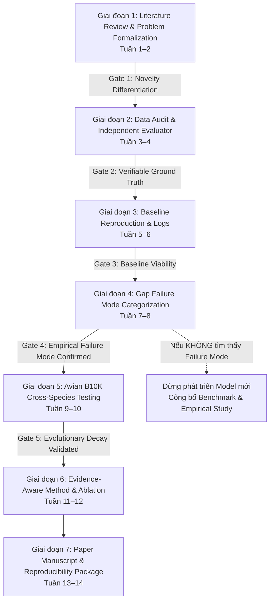

# PhyloGap: Kế hoạch Triển khai Chi tiết từng Giai đoạn (Detailed Execution Plan)

> **Mã tài liệu:** `SOP-PHYLOGAP-v1.0`  
> **Ngày phê duyệt:** 23/10/2026 · **Trạng thái:** Active Operational Blueprint  
> **Nguyên tắc xuyên suốt:** *Không chạy đua tiến độ, không làm tắt. Mỗi giai đoạn phải thỏa mãn 100% Tiêu chí Đạt (Done Criteria) và tạo ra Artifacts kiểm chứng được trước khi chuyển bước.*

---

## 1. Sơ đồ Cấu trúc Tổng thể & Các Cổng Quyết định (Decision Gates)

---

## 2. Đặc tả Chi tiết Từng Giai đoạn (Detailed Stage Specifications)

---

### GIAI ĐOẠN 1: Literature Survey, Mathematical Formulation & Novelty Differentiation
* **Thời gian dự kiến:** Tuần 1–2
* **Mục tiêu:** Rà soát có hệ thống, mổ xẻ tường tận cơ chế của 7 công trình SOTA; chứng minh bằng toán học và thực nghiệm rằng các mô hình AI 2024–2026 vẫn tồn tại điểm mù.

#### Danh mục Nhiệm vụ Chi tiết (Action Items)
1. **Rà soát sâu 7 bài báo hạt nhân:**
   * *DENTIST (2022)*: Giải mã thuật toán repeat-aware alignment và cơ chế Validation Filter.
   * *GapPredict (2021)*: Phân tích kiến trúc LSTM language model và hạn chế của greedy generation.
   * *DLGapCloser (2024)*: Mổ xẻ mạng DGCNet (CNN-BiLSTM) và thuật toán tìm kiếm Wave-Beam Search.
   * *DL-GapFilling (2026)*: Đối chiếu mạng DFillingNet, thuật toán BeamStar và bộ lọc PredictionFilter.
   * *GapSuite (2026)*: Nghiên cứu phương pháp mở rộng Gap-Aid và đồ thị Gap-Graph cho mục tiêu T2T.
   * *Comprehensive Evaluation (2024)*: Tham chiếu cách thiết kế ma trận đo lường accuracy vs completeness trên đa bội.
   * *B10K Comparative Genomics (2020)*: Nắm rõ cấu trúc dữ liệu phả hệ và whole-genome alignment của chim.
2. **Hình thức hóa bài toán bằng toán học (Mathematical Formulation):**
   * Định nghĩa không gian đầu vào: Bản lắp ráp phân mảnh $\mathcal{A}$, tập đọc thô $\mathcal{R}$, hệ gen tham chiếu tương đồng $\mathcal{G}_{ref}$ tại khoảng cách phát sinh loài $d_{phylo}$.
   * Định nghĩa hàm mục tiêu: Tối đa hóa xác suất chuỗi nucleotide chính xác $\arg\max_S P(S \mid \text{flanks}, \mathcal{R}, \mathcal{G}_{ref})$ đồng thời cực tiểu hóa False-Closure Rate ($FCR$).
3. **Phân tích đối chuẩn tính mới (Novelty Defense Document):**
   * Soạn thảo bảng ma trận chỉ rõ tại sao việc áp dụng Transformer đơn thuần không tạo nên novelty, mà tính mới nằm ở **cơ chế dung hòa mâu thuẫn đa bằng chứng (evidence-aware)** và **kiểm soát rủi ro từ chối dự đoán (selective prediction)**.

#### Tiêu chí Hoàn thành Giai đoạn 1 (Done Criteria)
- [x] Tệp [docs/literature_matrix.md](file:///d:/THStudy/UniversityStudy/Research/phylogap/docs/literature_matrix.md) hoàn thành với 7 chiều so sánh cho 7 công trình.
- [ ] Soạn thảo bản tổng hợp lý thuyết [docs/literature_review_synthesis.md](file:///d:/THStudy/UniversityStudy/Research/phylogap/docs/literature_review_synthesis.md) có trích dẫn đầy đủ (BibTeX).
- [ ] Vượt qua **Gate 1**: Xác định rõ 3 failure modes của SOTA mà chưa công trình nào giải quyết.

---

### GIAI ĐOẠN 2: Data Audit, Ground Truth Standardization & Independent Evaluator
* **Thời gian dự kiến:** Tuần 3–4
* **Mục tiêu:** Hoàn thiện toàn bộ hạ tầng dữ liệu thực nghiệm, tải các bộ genome chuẩn, xây dựng công cụ đo lường độc lập (`evaluate_metrics.py`) chuẩn hóa quốc tế để không phụ thuộc vào script riêng lẻ của từng bài báo.

#### Danh mục Nhiệm vụ Chi tiết (Action Items)
1. **Hoàn tất Thẩm định Thực nghiệm Dữ liệu (Empirical EDA):**
   * Tải và phân tích phân vị độ dài gap của *D. melanogaster* (1,374 gap) và *Calypte anna* (38,996 gap).
   * Đo lường độ lệch GC (GC bias) và độ giàu yếu tố lặp (homopolymers, dinucleotide repeats) bên trong các gap thực tế.
2. **Xây dựng Script Đo lường Độc lập (`scripts/evaluate_metrics.py`):**
   * Căn chỉnh cục bộ tối ưu (*Smith-Waterman / Needleman-Wunsch*) giữa sequence dự đoán và ground truth sequence.
   * Tính toán các chỉ số:
     * **Nucleotide Accuracy ($Acc_{nuc}$):** Tỷ lệ nucleotide khớp chính xác.
     * **Error Decomposition:** Tách bạch tỷ lệ Substitution, Insertion, Deletion.
     * **Exact-Match Rate:** Tỷ lệ gap khớp 100% không sai khác.
     * **False-Closure Rate ($FCR$):** Tỷ lệ gap được công cụ khẳng định đã điền nhưng bị sai vượt ngưỡng dung sai ($>10\%$ lỗi hoặc sai độ dài $>20\%$).
     * **Risk–Coverage Curve & AU-RC:** Đánh giá chất lượng của cơ chế chấm điểm độ tin cậy.
3. **Thiết kế Clade Thử nghiệm Chim B10K (Avian Taxa Selection):**
   * Lựa chọn 4 cặp loài chim đại diện cho 4 mốc thời gian phân tách tiến hóa:
     * *Cùng chi ($<5$ Mya):* *Taeniopygia guttata* vs. *Taeniopygia bichenovii*.
     * *Cùng họ ($10-15$ Mya):* *Taeniopygia guttata* vs. *Lonchura striata*.
     * *Cùng bộ ($35-45$ Mya):* *Gallus gallus* vs. *Numida meleagris*.
     * *Khác bộ ($>80$ Mya):* *Calypte anna* vs. *Gallus gallus*.

#### Tiêu chí Hoàn thành Giai đoạn 2 (Done Criteria)
- [x] Tệp [docs/data_manifest.md](file:///d:/THStudy/UniversityStudy/Research/phylogap/docs/data_manifest.md) hoàn thành với số liệu thống kê phân vị và phân tầng gap.
- [x] Kịch bản [scripts/analyze_gap_sequences.py](file:///d:/THStudy/UniversityStudy/Research/phylogap/scripts/analyze_gap_sequences.py) chạy trích xuất thành công đặc tính sinh học của 1,374 gap ground truth.
- [ ] Kịch bản `scripts/evaluate_metrics.py` được viết và vượt qua bộ unit test kiểm thử trên các chuỗi tổng hợp có lỗi chèn/xóa/thay thế.
- [ ] Vượt qua **Gate 2**: Toàn bộ dữ liệu benchmark pilot có ground truth kiểm chứng được 100%.

---

### GIAI ĐOẠN 3: Baseline Reproduction & Execution Footprint
* **Thời gian dự kiến:** Tuần 5–6
* **Mục tiêu:** Cài đặt và thực thi các công cụ đại diện trong môi trường cô lập, ghi nhận log tài nguyên (RAM, CPU, Runtime) và tái lập độ chính xác trên tập dữ liệu pilot.

#### Danh mục Nhiệm vụ Chi tiết (Action Items)
1. **Thiết lập Môi trường Độc lập (Isolated Environments):**
   * Tạo môi trường Conda cho DENTIST (`envs/environment_dentist.yml`): Snakemake, Dazzler suite (DBsplit, daligner), D compiler runtime.
   * Tạo môi trường Conda cho AI baselines (`envs/environment_ai.yml`): PyTorch, Biopython, samtools, minimap2.
2. **Thực thi Track 1 (Read-Supported Baselines):**
   * Chạy DENTIST trên *Drosophila* với các mức độ phủ đọc PacBio: $5\times, 10\times, 20\times$.
   * Thu thập log tài nguyên: Peak RSS Memory (GB), CPU core-hours, Throughput (gaps/minute).
3. **Thực thi Track 2 (Learning-Based Baselines):**
   * Tái lập mô hình dạng GapPredict (LSTM) và DGCNet (CNN-BiLSTM) trên các gap pilot.
   * Chạy thuật toán tìm kiếm Beam Search vs. Wave-Beam Search để đo lường tốc độ suy luận.
4. **Chuẩn hóa Kết quả Đầu ra:**
   * Xuất toàn bộ chuỗi được điền ra định dạng FASTA chuẩn.
   * Đưa qua script `evaluate_metrics.py` của PhyloGap để chấm điểm công bằng trên cùng một thước đo.

#### Tiêu chí Hoàn thành Giai đoạn 3 (Done Criteria)
- [ ] DENTIST chạy hoàn tất trên pilot dataset, đạt kết quả tương thích với báo cáo của Hiller Lab.
- [ ] Ít nhất 1 AI baseline chạy hoàn tất và xuất ra chuỗi nucleotide đầy đủ.
- [ ] Tạo bảng tổng hợp `experiments/results/baseline_pilot_comparison.csv`.
- [ ] Vượt qua **Gate 3**: Không có công cụ nào bị lỗi môi trường hoặc crash không thể khắc phục.

---

### GIAI ĐOẠN 4: Error Decomposition & Gap Failure Mode Categorization
* **Thời gian dự kiến:** Tuần 7–8
* **Mục tiêu:** Trả lời triệt để **RQ2** (Xác định failure modes thực tế). Đây là "bộ lọc khoa học" quyết định có cần thuật toán mới hay không.

#### Danh mục Nhiệm vụ Chi tiết (Action Items)
1. **Phân tích Tương quan Đa biến (Multivariate Error Analysis):**
   * Tính toán ma trận tương quan giữa tỷ lệ lỗi dự đoán ($Acc_{nuc}$, $FCR$) với các đặc trưng của gap:
     * Kích thước gap ($<50$ bp, $50-200$ bp, $200-1000$ bp, $\ge 1000$ bp).
     * Mức độ lặp (Homopolymer runs $\ge 6$ bp, Dinucleotide repeats).
     * Độ lệch GC ($\Delta GC = GC_{gap} - GC_{flank}$).
     * Mức độ hỗ trợ của reads (Spanning reads $>5$, $1-5$, hoặc $0$).
2. **Lập Danh mục Failure Modes (`docs/failure_modes_catalog.md`):**
   * **Failure Mode A (Repeats & Ambiguity):** Vùng lặp cao khiến read alignment bị multi-mapping, trong khi AI model bị lặp chuỗi vô tận (*repetitive degeneration*).
   * **Failure Mode B (Zero-Coverage Break):** Vùng khuyết hoàn toàn không có reads spanning, DENTIST buộc phải từ chối điền, AI model sinh chuỗi ảo tưởng (*hallucination*).
   * **Failure Mode C (Length-Dependent Error Accumulation):** Gap dài $>200$ bp khiến sai số tích tụ, độ chính xác giảm mạnh sau mỗi bước sinh ký tự.
3. **Họp Đánh giá Cổng Quyết định Gate 4:**
   * Nếu SOTA đã giải quyết tốt mọi failure modes $\rightarrow$ Dừng xây dựng model mới, công bố bài báo dạng Comprehensive Benchmark.
   * Nếu xác nhận failure mode định lượng có ý nghĩa $\rightarrow$ Tiến hành phát triển thuật toán khắc phục có mục tiêu.

#### Tiêu chí Hoàn thành Giai đoạn 4 (Done Criteria)
- [ ] Tệp `docs/failure_modes_catalog.md` được phê duyệt với bằng chứng định lượng rõ ràng.
- [ ] Biểu đồ trực quan hóa lỗi (Error Breakdown Barplots & Scatterplots) được xuất ra thư mục `experiments/figures/`.
- [ ] Vượt qua **Gate 4**: Có bằng chứng vững chắc về một giới hạn khoa học cụ thể của các công cụ hiện có.

---

### GIAI ĐOẠN 5: Avian B10K Cross-Species Generalization
* **Thời gian dự kiến:** Tuần 9–10
* **Mục tiêu:** Trả lời triệt để **RQ3** (Tác động của khoảng cách phát sinh loài đối với việc tái dựng gap).

#### Danh mục Nhiệm vụ Chi tiết (Action Items)
1. **Thiết lập Giao thức Kiểm thử Species-Held-Out:**
   * Chọn bộ gene mục tiêu: *Taeniopygia guttata* (Zebra finch) hoặc *Calypte anna* (Hummingbird).
   * Áp dụng reference genome từ 4 mức khoảng cách:
     * Gần ($3-5$ Mya)
     * Trung bình ($10-15$ Mya)
     * Xa ($35-45$ Mya)
     * Rất xa ($>80$ Mya)
2. **Đo lường Sự Suy thoái Tiến hóa (Evolutionary Divergence Decay):**
   * Đo lường tốc độ suy giảm của $Acc_{nuc}$ và sự gia tăng của $FCR$ theo hàm số của khoảng cách tiến hóa $d_{phylo}$.
   * Xác định điểm gãy (*inflection point*): Khoảng cách tiến hóa tối đa mà tại đó thông tin tương đồng vẫn còn mang lại giá trị tích cực cho gap filling.
3. **Phân tích Tính bảo tồn Cục bộ (Local Synteny & Conservation):**
   * Kết hợp điểm bảo tồn *PhastCons / PhyloP* để xem xét liệu các gap nằm trong vùng gen mã hóa protein có giữ được độ chính xác cao hơn vùng intergenic/intron hay không.

#### Tiêu chí Hoàn thành Giai đoạn 5 (Done Criteria)
- [ ] Báo cáo `docs/cross_species_generalization_report.md` hoàn thành.
- [ ] Xuất bản đường cong suy thoái tiến hóa định lượng đầu tiên trong lĩnh vực gap filling.
- [ ] Vượt qua **Gate 5**: Chứng minh được khoảng cách tiến hóa là một biến số độc lập ảnh hưởng then chốt đến độ chính xác.

---

### GIAI ĐOẠN 6: Evidence-Aware Method Design & Ablation Study
* **Thời gian dự kiến:** Tuần 11–12 (Chỉ thực hiện nếu Gates 4 & 5 ĐẠT)
* **Mục tiêu:** Phát triển prototype tối thiểu (Minimal Viable Algorithm) tập trung giải quyết đúng failure mode đã định lượng ở Giai đoạn 4 và 5.

#### Danh mục Nhiệm vụ Chi tiết (Action Items)
1. **Thiết kế Cơ chế Evidence-Aware Candidate Selection:**
   * Xây dựng module kết hợp 3 luồng bằng chứng:
     * $E_{read}$: Consensus từ các reads bắc qua gap (nếu có).
     * $E_{homology}$: Chuỗi tương đồng từ reference genome gần nhất, được hiệu chỉnh theo ma trận thay thế tiến hóa (PAM/BLOSUM tương ứng).
     * $E_{prior}$: Phân phối xác suất ngữ cảnh cục bộ từ mô hình ngôn ngữ nucleotide.
2. **Triển khai Cơ chế Selective Prediction (Từ chối Dự đoán An toàn):**
   * Thiết lập hàm chấm điểm tin cậy $C(S) \in [0, 1]$.
   * Áp dụng ngưỡng cắt $\tau$: Nếu $C(S) < \tau$, mô hình **giữ nguyên ký tự `N`**, bảo vệ bản lắp ráp không bị đưa thêm lỗi giả.
3. **Thực hiện Thí nghiệm Cắt bỏ Nghiêm ngặt (Ablation Study):**
   * Chạy đối chứng 4 cấu hình:
     * Cấu hình 1: Chỉ dùng Reads ($E_{read}$).
     * Cấu hình 2: Chỉ dùng Homology ($E_{homology}$).
     * Cấu hình 3: Mô hình lai không có Selective Prediction.
     * Cấu hình 4: Mô hình đầy đủ PhyloGap (Hybrid + Selective Prediction).
4. **Vẽ Đường cong Risk–Coverage (Risk-Coverage Curve):**
   * Chứng minh rằng mô hình đề xuất đạt Pareto Frontier tối ưu hơn hẳn SOTA về sự đánh đổi giữa độ chính xác và tỷ lệ gap được điền.

#### Tiêu chí Hoàn thành Giai đoạn 6 (Done Criteria)
- [ ] Prototype mã nguồn mở hoàn thành trong `src/phylogap/`.
- [ ] Kết quả Ablation Study chứng minh mọi thành phần đề xuất đều có đóng góp định lượng thực sự (P-value $< 0.05$).
- [ ] Giảm thiểu False-Closure Rate ít nhất 30% so với baseline AI khi áp dụng Selective Prediction.

---

### GIAI ĐOẠN 7: Review, Reproducibility Packaging & Paper Drafting
* **Thời gian dự kiến:** Tuần 13–14
* **Mục tiêu:** Đóng gói toàn bộ mã nguồn, dữ liệu, cấu hình thực nghiệm để người khác có thể tái lập 100% bằng một lệnh chạy; hoàn thiện bản thảo bài báo khoa học.

#### Danh mục Nhiệm vụ Chi tiết (Action Items)
1. **Kiểm tra Tính Tái lập Tuyệt đối (One-Command Reproducibility):**
   * Viết pipeline Snakemake hoặc Bash wrapper `run_all_experiments.sh` tái hiện toàn bộ bảng số liệu và hình vẽ từ dữ liệu thô.
   * Đóng gói Docker / Conda lockfile (`environment.lock.yml`).
2. **Soạn thảo Bản thảo Bài báo (Manuscript Drafting):**
   * Cấu trúc bài báo theo chuẩn quốc tế:
     * *Title:* Provisional title đã thống nhất.
     * *Abstract:* Bối cảnh, vấn đề, phương pháp, kết quả thực nghiệm then chốt, ý nghĩa sinh học.
     * *Introduction:* Dẫn dắt từ nhu cầu T2T/high-quality assembly, khoảng trống của SOTA, đóng góp chính.
     * *Methods:* Mô tả chi tiết dữ liệu, ground truth protocol, kiến trúc thuật toán, evaluation framework.
     * *Results:* Trình bày 5 cụm kết quả tương ứng với 5 Research Questions (RQ1–RQ5).
     * *Discussion & Limitations:* Phân tích khách quan các giới hạn, tài nguyên tính toán và hướng mở.
3. **Họp Tổng kết Dự án & Quyết định Hướng tiếp theo (Go/No-Go Decision):**
   * Quyết định nộp bài báo vào tạp chí/hội nghị phù hợp (*Bioinformatics, Briefings in Bioinformatics, hoặc GigaScience*).

#### Tiêu chí Hoàn thành Giai đoạn 7 (Done Criteria)
- [ ] Toàn bộ kho code sạch, có tài liệu hướng dẫn (`docs/API.md`, `README.md`).
- [ ] Bản thảo bài báo hoàn thiện định dạng LaTeX/Markdown (`manuscript/draft_v1.md`).
- [ ] Bộ dữ liệu và mã nguồn sẵn sàng công khai trên GitHub/Zenodo.

---

## 3. Ma trận Phân công và Kiểm soát Chất lượng (Quality Control Checklist)

Trước khi đánh dấu một Task là `Done`:
1. **Code:** Phải có docstrings, tuân thủ PEP8, không chứa hardcoded path tuyệt đối của máy cá nhân.
2. **Data:** Phải có checksum (MD5/SHA256) và được liệt kê rõ trong `docs/data_manifest.md`.
3. **Experiment:** Phải lưu đầy đủ log stdout/stderr, git commit hash tương ứng tại thời điểm chạy, seed ngẫu nhiên.
4. **Viết lách:** Không khẳng định tính mới chung chung; mọi tuyên bố phải được chứng minh bằng số liệu trong bảng kết quả.
