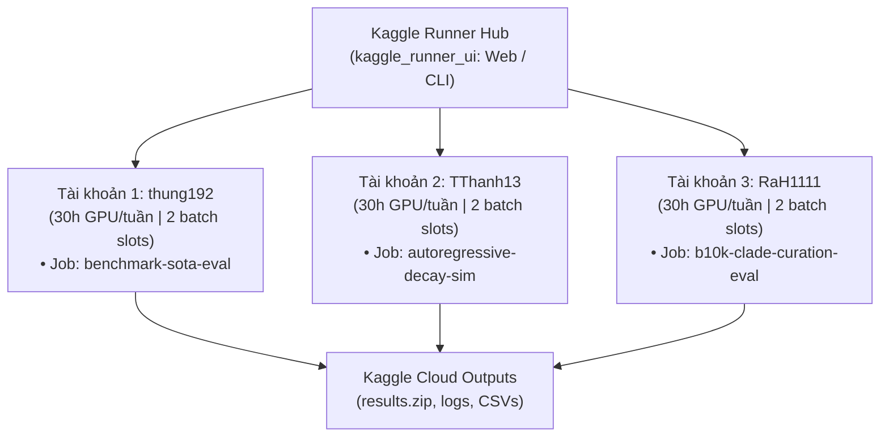

# PhyloGap: Kaggle Multi-Account & Remote Execution Guide

> **Document Status:** Active Standard Operating Procedure (SOP) · **Date:** 23/10/2026  
> **Repository Path:** `docs/KAGGLE_EXECUTION_GUIDE.md`  
> **Local Control Hub:** `kaggle_runner_ui/`  
> **Jupyter Notebook:** `notebooks/kaggle_phylogap_runner.ipynb`  
> **CLI Dispatcher:** `scripts/push_kaggle_phylogap.py`

---

## 1. Tổng quan Hệ thống Thực thi Điện toán Kaggle (Multi-Account Architecture)

Để giải quyết bài toán huấn luyện mô hình và chạy các thực nghiệm nặng (như trích xuất baseline DENTIST, sinh gap tổng hợp, mô phỏng tự hồi quy hàng nghìn gap) mà không bị giới hạn phần cứng máy trạm, PhyloGap đã tích hợp hệ thống **Kaggle Multi-Account Control Hub** với 3 tài khoản GPU độc lập:



### Tổng Năng lực Điện toán:
* **Tổng GPU Quota:** 90 giờ GPU T4/P100 miễn phí mỗi tuần.
* **Số luồng chạy song song đồng thời:** Tối đa 6 batch GPU slots.
* **Bảo mật tuyệt đối:** Toàn bộ token và thông tin xác thực (`kaggle.json`) được lưu cục bộ trong `kaggle_runner_ui/data/tokens/` và đã được chặn triệt để qua `.gitignore`, không bao giờ bị lộ lên GitHub.

---

## 2. Ba Phương thức Chạy Thực nghiệm trên Kaggle

### Cách 1: Sử dụng Giao diện Web Trực quan (Kaggle Runner UI) - Khuyến nghị

Đây là phương pháp trực quan và tiện lợi nhất:
1. **Khởi chạy máy chủ Web:**
   * Cách nhanh nhất trên Windows: **Click đúp chuột** vào tệp:
     ```text
     kaggle_runner_ui/run_windows.bat
     ```
   * Hoặc qua PowerShell:
     ```powershell
     python kaggle_runner_ui/server.py --port 8080 --open-browser
     ```
2. **Truy cập Giao diện:** Trình duyệt sẽ tự động mở tại `http://127.0.0.1:8080`.
3. **Thao tác trên Web:**
   * **Dashboard & Quotas:** Theo dõi trực tiếp số giờ GPU còn lại trên cả 3 tài khoản.
   * **Multi-Thread Dispatcher:** Nhấn nút **Push All Jobs** để đẩy song song 3 luồng thực nghiệm lên 3 tài khoản cùng lúc.
   * **Live Logs & Outputs:** Xem log chạy thời gian thực và tải tệp kết quả ZIP về máy chỉ với một click.

---

### Cách 2: Sử dụng Script Dòng lệnh (CLI Dispatcher)

Phù hợp khi làm việc nhanh qua terminal hoặc lập lịch tự động:

```powershell
# 1. Liệt kê danh sách các job và tài khoản phụ trách
python scripts/push_kaggle_phylogap.py --list

# 2. Kiểm tra trạng thái token, GPU quota và tiến độ kernel
python scripts/push_kaggle_phylogap.py --status

# 3. Đẩy 1 job cụ thể lên Kaggle (ví dụ: benchmark-sota-eval)
python scripts/push_kaggle_phylogap.py --push benchmark-sota-eval

# 4. Đẩy toàn bộ các job lên 3 tài khoản song song
python scripts/push_kaggle_phylogap.py --push-all

# 5. Tải kết quả đầu ra sau khi kernel hoàn thành
python scripts/push_kaggle_phylogap.py --download benchmark-sota-eval
```

---

### Cách 3: Chạy Tương tác bằng Jupyter Notebook trên Kaggle

Dành cho trường hợp muốn debug trực tiếp từng dòng code trên giao diện Kaggle Notebooks:

1. Mở Kaggle Notebook mới tại [kaggle.com/code](https://www.kaggle.com/code).
2. Vào **File** $\to$ **Upload Notebook** $\to$ Chọn file:
   ```text
   notebooks/kaggle_phylogap_runner.ipynb
   ```
3. Bật **Internet: On** trong mục **Settings** bên phải giao diện Kaggle.
4. Chọn **Accelerator: GPU T4 x2** (hoặc CPU).
5. Nhấn **Run All**:
   * Notebook sẽ tự động clone mã nguồn mới nhất từ [https://github.com/huanight19RaH/phylogap.git](https://github.com/huanight19RaH/phylogap.git).
   * Cài đặt `requirements.txt`.
   * Chạy toàn bộ 14 unit tests kiểm định chất lượng.
   * Chạy trích xuất SOTA baseline và mô phỏng suy thoái tự hồi quy.
   * Đóng gói toàn bộ kết quả vào `/kaggle/working/phylogap_experiment_results.zip` để tải về.

---

## 3. Cấu hình Chi tiết Các Job Mặc định (`data/projects.yaml`)

| Tên Job (Slug) | Tài khoản | Mục tiêu Kỹ thuật | Lệnh Thực thi Chính |
| :--- | :--- | :--- | :--- |
| **`benchmark-sota-eval`** | `account1`<br/>(`thung192`) | Chạy regression test 14 bài và trích xuất baseline DENTIST / PBJelly / LR_gapcloser | `python -m unittest discover tests`<br/>`python scripts/benchmark_baseline_evaluator.py` |
| **`autoregressive-decay-sim`** | `account2`<br/>(`TThanh13`) | Mô phỏng suy thoái tự hồi quy nucleotide và bẫy lặp trên các dải gap 10bp–1000bp | `python scripts/simulate_lm_gap_filling.py` |
| **`b10k-clade-curation-eval`** | `account3`<br/>(`RaH1111`) | Truy vấn NCBI API cho 4 bậc tiến hóa chim và tính toán ma trận độ đo AU-RC / FCR | `python scripts/query_b10k_metadata.py`<br/>`python scripts/evaluate_metrics.py` |

---

## 4. Quy trình Cập nhật & Đồng bộ Mã nguồn khi Chạy Kaggle

Do kernel Kaggle tải mã nguồn trực tiếp qua lệnh `git clone`:
1. Trước khi bấm **Push** trên UI hoặc chạy CLI, luôn đảm bảo các thay đổi mới đã được commit và push lên GitHub:
   ```powershell
   git add .
   git commit -m "feat: your new feature"
   git push origin main
   ```
2. Kaggle Runner sẽ tự động kéo phiên bản mới nhất từ `main` về và thực thi.
