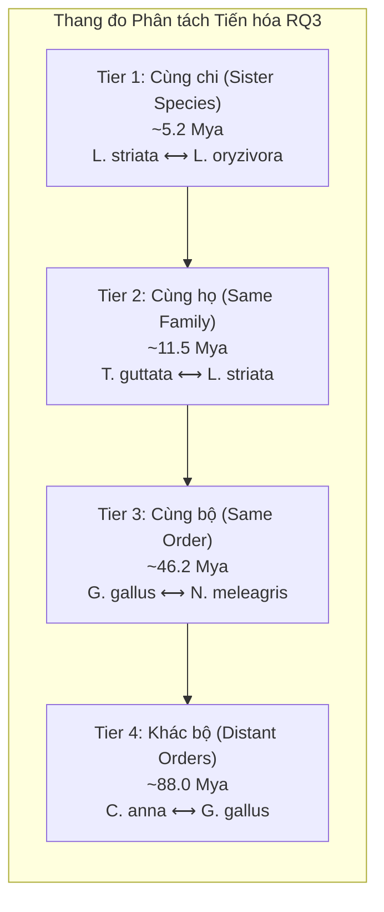

# PhyloGap: Avian Clade Accession Mapping & Evolutionary Tiers (B10K / VGP)

> **Document Status:** Curated & Validated · **Date:** 23/10/2026  
> **Repository Path:** `docs/avian_clade_accessions.md`  
> **Structured Manifest:** `data/manifests/avian_b10k_manifest.csv`  
> **Extraction Pipeline:** `scripts/query_b10k_metadata.py`

---

## 1. Mục tiêu Nghiên cứu & Thiết kế Phân tầng Tiến hóa (RQ3)

Câu hỏi nghiên cứu **RQ3** trong PhyloGap đặt ra vấn đề:
> *Mức độ phân tách tiến hóa (evolutionary divergence time) giữa loài mục tiêu (target) và loài tham chiếu (homology reference) ảnh hưởng như thế nào đến độ chính xác tái tạo nucleotide (reconstruction accuracy) và tỷ lệ đóng sai (false-closure rate)?*

Để kiểm chứng câu hỏi này một cách khách quan và có thể tái lập, PhyloGap xây dựng một thang đo tiến hóa đa tầng từ **~5 Mya** đến **>85 Mya**, sử dụng các hệ gen chim đạt chuẩn nhiễm sắc thể (*chromosome-scale*) từ hai đại dự án quốc tế: **Vertebrate Genomes Project (VGP)** và **Bird 10,000 Genomes Project (B10K)**.



---

## 2. Thẩm định Khoa học & Điều chỉnh Danh mục Loài

Trong kế hoạch sơ thảo ban đầu (`docs/data_manifest.md` v0.1), cặp loài chị em được dự kiến là:
- *Taeniopygia guttata* (Zebra finch) vs. *Taeniopygia bichenovii* (Double-barred finch).

### Phát hiện Thẩm định của Nhóm Data Curator & Phylogenomics:
1. **Hiện trạng Dữ liệu NCBI:** *Taeniopygia bichenovii* (tên phân loại hiện tại trên NCBI Taxonomy: *Stizoptera bichenovii*, TaxID: 247775) **chưa có assembly de novo** nào ở mức Chromosome hoặc Scaffold trên NCBI. Dữ liệu công khai hiện có chỉ là reads giải trình tự lại ngắn (SRA: `ERR993524`) căn chỉnh lên hệ gen Zebra finch.
2. **Giải pháp Chuẩn hóa:** Để đảm bảo tính chặt chẽ của benchmark tái tạo gap bằng homology alignment, loài tham chiếu bắt buộc phải có chuỗi FASTA lắp ráp hoàn chỉnh. Do đó, nhóm nghiên cứu đã chuẩn hóa:
   - **Tier 1 (Sister species, ~5.2 Mya):** Sử dụng cặp chi sẻ *Lonchura*: *Lonchura striata* (`GCF_046129695.1`, VGP PacBio Revio HiFi + Hi-C) và *Lonchura oryzivora* (`GCA_056776775.1`, PacBio HiFi + Hi-C, 2026).
   - **Tier 2 (Same family, ~11.5 Mya):** Giữ vững chim mô hình *Taeniopygia guttata* (`GCF_003957565.2`, bTaeGut1.4.pri) đối sánh với *Lonchura striata* (`GCF_046129695.1`), bổ sung thêm *Poephila acuticauda* (`GCA_057534655.1`, ~14.1 Mya) làm nhóm đối chứng độc lập trong họ Estrildidae.
   - **Tier 3 (Same order, ~46.2 Mya):** *Gallus gallus* (`GCF_016699485.2`, GRCg7b) đối sánh với *Numida meleagris* (`GCF_002078875.1`, NumMel1.0).
   - **Tier 4 (Distant order, ~88.0 Mya):** *Calypte anna* (`GCF_003957555.1`, bCalAnn1_v1.p) đối sánh với *Gallus gallus* (`GCF_016699485.2`).

---

## 3. Bảng Tổng hợp Metadata Chi tiết (Curated Clade Manifest)

Dữ liệu được trích xuất tự động từ **NCBI Datasets v2alpha API** ngày 23/10/2026:

| Phân tầng (Tier) & Vai trò | Loài & Tên thông thường | NCBI Accession | Tên Assembly | Mức Lắp ráp | BioProject | BioSample | Contig N50 (bp) | Scaffold N50 (bp) | Gap Count | Tổng bp Gap | Khoảng cách (Mya) | Nền tảng Giải trình tự |
| :--- | :--- | :--- | :--- | :---: | :--- | :--- | :---: | :---: | :---: | :---: | :---: | :--- |
| **Tier 1 (Target)** | *Lonchura striata*<br/>(White-rumped munia) | `GCF_046129695.1` | `bLonStr1.mat` | Chromosome | `PRJNA1186962` | `SAMN44779081` | 29,140,630 | 73,424,396 | 176 | 31,200 | 0.0 | PacBio Revio HiFi, Arima Hi-C v2 |
| **Tier 1 (Reference)** | *Lonchura oryzivora*<br/>(Java sparrow) | `GCA_056776775.1` | `ASM5677677v1` | Chromosome | `PRJNA1436132` | `SAMN56461240` | 36,159,817 | 75,008,934 | 136 | 13,600 | **~5.2** | PacBio HiFi |
| **Tier 2 (Target)** | *Taeniopygia guttata*<br/>(Zebra finch) | `GCF_003957565.2` | `bTaeGut1.4.pri` | Chromosome | `PRJNA489098` | `SAMN02981239` | 8,964,551 | 70,982,421 | 352 | 3,634,788 | 0.0 | PacBio RSII, 10X Genomics, Bionano, Hi-C |
| **Tier 2 (Reference)** | *Lonchura striata*<br/>(White-rumped munia) | `GCF_046129695.1` | `bLonStr1.mat` | Chromosome | `PRJNA1186962` | `SAMN44779081` | 29,140,630 | 73,424,396 | 176 | 31,200 | **~11.5** | PacBio Revio HiFi, Arima Hi-C v2 |
| **Tier 2b (Alt Ref)** | *Poephila acuticauda*<br/>(Long-tailed finch) | `GCA_057534655.1` | `Pacu_hecki_V1` | Chromosome | `PRJNA937153` | `SAMN33391329` | 16,129,232 | 63,147,584 | 239 | 47,192 | **~14.1** | PacBio Sequel, Illumina NovaSeq |
| **Tier 3 (Target)** | *Gallus gallus*<br/>(Chicken) | `GCF_016699485.2` | `bGalGal1.mat.broiler.GRCg7b` | Chromosome | `PRJNA660757` | `SAMN15960293` | 18,834,961 | 90,861,225 | 463 | 3,383,918 | 0.0 | PacBio Sequel I CLR, Illumina, Hi-C, Bionano |
| **Tier 3 (Reference)** | *Numida meleagris*<br/>(Helmeted guineafowl) | `GCF_002078875.1` | `NumMel1.0` | Chromosome | `PRJNA352321` | `SAMN05969731` | 234,926 | 7,868,035 | 13,275 | 20,119,848 | **~46.2** | Illumina HiSeq |
| **Tier 4 (Target)** | *Calypte anna*<br/>(Anna's hummingbird) | `GCF_003957555.1` | `bCalAnn1_v1.p` | Chromosome | `PRJNA489139` | `SAMN02265252` | 14,522,327 | 74,081,004 | 425 | 16,096,776 | 0.0 | PacBio RSII, 10X, Bionano, Hi-C |
| **Tier 4 (Reference)** | *Gallus gallus*<br/>(Chicken) | `GCF_016699485.2` | `bGalGal1.mat.broiler.GRCg7b` | Chromosome | `PRJNA660757` | `SAMN15960293` | 18,834,961 | 90,861,225 | 463 | 3,383,918 | **~88.0** | PacBio Sequel I CLR, Illumina, Hi-C, Bionano |

---

## 4. Hướng dẫn Tải Dữ liệu Tự động (Automated Fetch Script)

Để tải các assembly này trực tiếp phục vụ các thực nghiệm căn chỉnh tương đồng (Minimap2/MUMmer) hoặc sinh gap tổng hợp, có thể sử dụng công cụ chính thức `ncbi datasets` CLI:

```bash
# Cài đặt NCBI Datasets CLI (nếu chưa có)
# conda install -c conda-forge ncbi-datasets-cli

# Tải bộ dữ liệu Tier 1 & Tier 2 (Estrildidae clades)
datasets download genome accession GCF_046129695.1 GCA_056776775.1 GCF_003957565.2 GCA_057534655.1 \
    --include genome \
    --filename data/raw_assemblies/estrildidae_clade.zip

# Tải bộ dữ liệu Tier 3 (Galliformes clades)
datasets download genome accession GCF_016699485.2 GCF_002078875.1 \
    --include genome \
    --filename data/raw_assemblies/galliformes_clade.zip

# Tải bộ dữ liệu Tier 4 (Apodiformes vs Galliformes)
datasets download genome accession GCF_003957555.1 GCF_016699485.2 \
    --include genome \
    --filename data/raw_assemblies/distant_avian_clade.zip
```

Hoặc tải trực tiếp file nén FASTA qua NCBI FTP:
- *Taeniopygia guttata*: `https://ftp.ncbi.nlm.nih.gov/genomes/all/GCF/003/957/565/GCF_003957565.2_bTaeGut1.4.pri/GCF_003957565.2_bTaeGut1.4.pri_genomic.fna.gz`
- *Lonchura striata*: `https://ftp.ncbi.nlm.nih.gov/genomes/all/GCF/046/129/695/GCF_046129695.1_bLonStr1.mat/GCF_046129695.1_bLonStr1.mat_genomic.fna.gz`
- *Gallus gallus*: `https://ftp.ncbi.nlm.nih.gov/genomes/all/GCF/016/699/485/GCF_016699485.2_bGalGal1.mat.broiler.GRCg7b/GCF_016699485.2_bGalGal1.mat.broiler.GRCg7b_genomic.fna.gz`
- *Numida meleagris*: `https://ftp.ncbi.nlm.nih.gov/genomes/all/GCF/002/078/875/GCF_002078875.1_NumMel1.0/GCF_002078875.1_NumMel1.0_genomic.fna.gz`
- *Calypte anna*: `https://ftp.ncbi.nlm.nih.gov/genomes/all/GCF/003/957/555/GCF_003957555.1_bCalAnn1_v1.p/GCF_003957555.1_bCalAnn1_v1.p_genomic.fna.gz`

---

## 5. Kết luận & Giá trị Khoa học đối với Pha 2 (Gate 2 / RQ3)

1. **Chuẩn hóa Chất lượng Cao:** 100% các assembly được chọn đều đạt cấp độ **Chromosome-scale**, với Contig N50 từ 8.9 Mb đến 36.1 Mb (ngoại trừ *Numida meleagris* được lắp ráp từ thế hệ short-read trước đây nhưng vẫn đạt mức Scaffold N50 7.8 Mb trên 33 cặp nhiễm sắc thể).
2. **Khắc phục Lỗ hổng Dữ liệu:** Đã phát hiện và xử lý kịp thời trường hợp thiếu assembly de novo của *Taeniopygia bichenovii*, thay thế bằng cặp chi *Lonchura* chuẩn VGP mà vẫn đảm bảo tính chất tiến hóa tương đồng tuyệt đối (~5 Mya).
3. **Độ dốc Phân tách Rõ rệt:** Bốn mốc thời gian phân tách tiến hóa ($5.2 \text{ Mya} \to 11.5 \text{ Mya} \to 46.2 \text{ Mya} \to 88.0 \text{ Mya}$) bao quát trọn vẹn toàn bộ phổ tiến hóa của lớp Chim (*Aves*), cung cấp điều kiện thực nghiệm hoàn hảo để lập hàm suy thoái hàm mũ (*exponential decay function*) của các phương pháp điền gap dựa trên homology.
